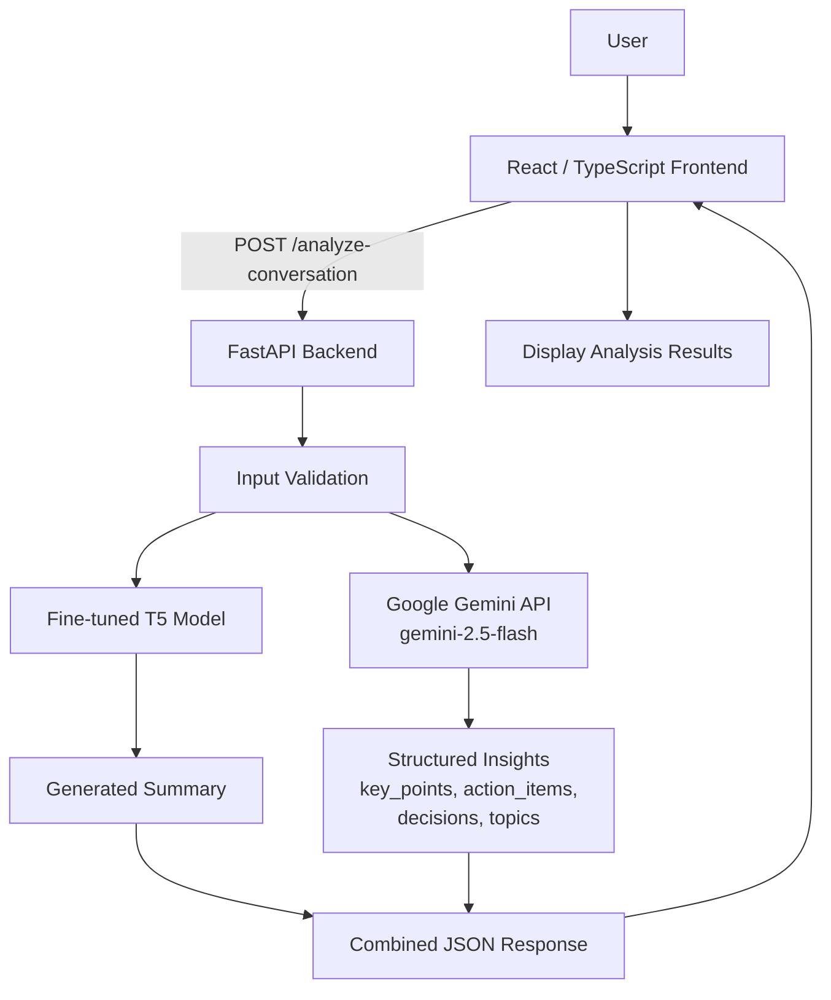

# SummarAI — Conversation Intelligence

**Turn unstructured conversations into a concise summary and structured, actionable insights.**

SummarAI is an AI-powered conversation intelligence application that combines a locally loaded, fine-tuned T5 summarization model with Google Gemini to analyze a conversation in one request. It returns an abstractive summary alongside key points, action items, decisions, and discussion topics.

> **Model responsibilities:** the fine-tuned T5 model generates the summary. Gemini (`gemini-2.5-flash`) extracts structured insights. Gemini is not used to generate the T5 summary.

<p align="center">
  <a href="https://github.com/mohammadkaif-28/conversation-summarizer">
    
  </a>
  <a href="https://huggingface.co/KaifAIML/summarAI-t5">
    
  </a>
  
  
  
</p>

---

## Table of Contents

- [Overview](#overview)
- [Features](#features)
- [How It Works](#how-it-works)
- [Architecture](#architecture)
- [Technology Stack](#technology-stack)
- [Repository Structure](#repository-structure)
- [Prerequisites](#prerequisites)
- [Getting Started](#getting-started)
  - [1. Clone the Repository](#1-clone-the-repository)
  - [2. Set Up the Backend](#2-set-up-the-backend)
  - [3. Configure Environment Variables](#3-configure-environment-variables)
  - [4. Set Up the T5 Model](#4-set-up-the-t5-model)
  - [5. Run the Backend](#5-run-the-backend)
  - [6. Run the Frontend](#6-run-the-frontend)
- [API Documentation](#api-documentation)
- [Example](#example)
- [Security and Privacy](#security-and-privacy)
- [Limitations](#limitations)
- [Troubleshooting](#troubleshooting)
- [Future Improvements](#future-improvements)
- [Learning Outcomes](#learning-outcomes)
- [References](#references)
- [Author](#author)

## Overview

Meetings, interviews, brainstorming sessions, and team discussions often contain useful information buried in long transcripts. Manually reviewing a conversation to identify its main message, decisions, and follow-up work can take time.

SummarAI addresses this problem by accepting a text conversation and producing two complementary outputs:

1. **A natural-language summary** generated by a fine-tuned T5 sequence-to-sequence Transformer.
2. **Structured conversation insights** extracted with the Google Gemini API and validated against a Pydantic schema.

The backend exposes the combined result through a FastAPI endpoint. The frontend provides the user-facing interface for submitting conversations and reviewing the returned analysis.

**Project:** SummarAI — Conversation Intelligence  
**Academic report title:** Conversation Intelligence System  
**Repository:** [mohammadkaif-28/conversation-summarizer](https://github.com/mohammadkaif-28/conversation-summarizer)  
**Fine-tuned model:** [KaifAIML/summarAI-t5](https://huggingface.co/KaifAIML/summarAI-t5)

## Features

- **Abstractive summarization:** generates a concise summary using a locally loaded fine-tuned T5 model.
- **Structured key points:** extracts important requirements, observations, and technical details.
- **Action-item extraction:** returns tasks with an associated assignee when the conversation supports one.
- **Decision extraction:** identifies stated conclusions, agreements, milestones, or deadlines.
- **Topic identification:** lists the main themes discussed.
- **Combined analysis API:** returns the summary and structured insights in one JSON response.
- **Typed response structure:** uses Pydantic models to define the expected shape of extracted insights.
- **CPU/GPU model selection:** uses CUDA when available and otherwise runs the T5 model on CPU.
- **Interactive API documentation:** FastAPI provides a Swagger UI at `/docs`.
- **Web interface:** a React/TypeScript frontend communicates with the backend API.

The quality of the output depends on the conversation text, the local model, and the Gemini response. The system does not guarantee that every extracted statement is correct.

## How It Works

1. A user enters a conversation in the frontend.
2. The frontend sends the conversation to `POST /analyze-conversation`.
3. FastAPI validates the request and passes the text to the analysis functions.
4. The T5 tokenizer prepares the text with the `summarize:` prefix and truncates the input to a maximum of 512 tokens.
5. The fine-tuned T5 model generates the abstractive summary.
6. The Gemini `gemini-2.5-flash` model extracts key points, action items, decisions, and topics using a structured JSON schema.
7. The API combines both outputs into one JSON response.
8. The frontend displays the summary and structured insights.

The current backend runs the summarization and insight-extraction calls sequentially, not in parallel.

## Architecture



## Technology Stack

| Component | Technology | Purpose |
|---|---|---|
| Summarization model | Fine-tuned T5 | Generates the conversation summary |
| Model runtime | PyTorch and Transformers | Loads and runs the local model checkpoint |
| Tokenization | Hugging Face Tokenizer | Prepares the conversation for T5 |
| Insight extraction | Google Gen AI SDK, Gemini 2.5 Flash | Extracts structured conversation information |
| Backend API | FastAPI | Handles requests and returns JSON |
| Data validation | Pydantic | Defines request and structured insight schemas |
| Configuration | `python-dotenv` | Loads environment configuration from `.env` |
| Frontend | React, TypeScript, Tailwind CSS | User interface |
| Frontend tooling | Vite (expected by the `VITE_API_URL` configuration) | Frontend development/build tooling |

## Repository Structure

The following is a **high-level structure** based on the project files available for documentation. It intentionally omits virtual environments, caches, and model-weight files.

```text
conversation-summarizer/
├── backend/
│   ├── app.py
│   ├── key_information_extractor.py
│   ├── requirements.txt
│   └── saved_model/             # Local T5 checkpoint and tokenizer files
├── frontend/
│   ├── package.json
│   ├── src/
│   └── ...                      # React/TypeScript frontend files
├── screenshots/                 # Add or keep actual UI screenshots here
├── .gitignore
└── README.md
```

The exact frontend subfolders and screenshot filenames should be checked against the current repository before adding file-specific links. Do not commit virtual environments (`venv/`, `venv_old/`), Python caches, `.env` files, or large generated files.

## Prerequisites

- Python **3.12** is the recommended Python version for the backend environment.
- Node.js and npm compatible with the frontend's installed dependencies.
- A Google Gemini API key for structured insight extraction.
- The fine-tuned T5 model checkpoint and tokenizer files.
- Internet access when calling the Gemini API and when downloading dependencies or model files.
- Sufficient RAM and disk space for PyTorch and the local T5 checkpoint.

A CUDA-capable GPU is optional. The backend is written to fall back to CPU when CUDA is unavailable.

## Getting Started

### 1. Clone the Repository

```bash
git clone https://github.com/mohammadkaif-28/conversation-summarizer.git
cd conversation-summarizer
```

### 2. Set Up the Backend

Create a virtual environment from the repository root.

**Windows PowerShell**

```powershell
py -3.12 -m venv .venv
.\.venv\Scripts\Activate.ps1
python -m pip install --upgrade pip
pip install -r backend/requirements.txt
```

If PowerShell blocks environment activation, follow your machine's execution-policy guidance or run the environment's Python directly.

**Linux/macOS**

```bash
python3.12 -m venv .venv
source .venv/bin/activate
python -m pip install --upgrade pip
pip install -r backend/requirements.txt
```

If the project requirements are installed from within the `backend` directory instead, use `pip install -r requirements.txt` after changing into that directory.

### 3. Configure Environment Variables

The backend uses `python-dotenv` and the Google Gen AI SDK. Configure the Gemini key in a local environment file, typically `backend/.env`, if that is the path used by your local run configuration.

Create `backend/.env` with a placeholder replaced by your own key:

```dotenv
GOOGLE_API_KEY=your_gemini_api_key_here
```

The Google Gen AI client is initialized in the backend with `genai.Client()`. The SDK needs a valid API-key configuration, commonly supplied through `GOOGLE_API_KEY`.

For the frontend, configure its API base URL using the `VITE_API_URL` variable if the frontend source reads that variable. For local development, the value will typically point to the backend, for example:

```dotenv
VITE_API_URL=http://127.0.0.1:8000
```

Place the frontend variable in the frontend's local environment file (usually `frontend/.env` for Vite projects). Confirm the variable name and exact usage in the frontend API service before running the application.

**Secret-handling rules**

- Never commit a real API key or private `.env` file.
- Keep `.env` files in `.gitignore`.
- Do not put the Gemini key in a frontend environment variable: frontend variables may be exposed to the browser.
- Restart the backend after changing its environment configuration.

### 4. Set Up the T5 Model

The backend loads the T5 tokenizer and model from a local checkpoint under `backend/saved_model`. It does not automatically download the checkpoint as part of each API request.

The model is also published on Hugging Face:

[https://huggingface.co/KaifAIML/summarAI-t5](https://huggingface.co/KaifAIML/summarAI-t5)

If `backend/saved_model/` is not present or does not contain the required model and tokenizer files, download the model repository using the Hugging Face CLI or `huggingface_hub` and place the downloaded files in the local checkpoint directory expected by `backend/app.py`.

Example using the Hugging Face CLI (install `huggingface_hub` first if needed):

```bash
python -m pip install -U huggingface_hub
hf download KaifAIML/summarAI-t5 --local-dir backend/saved_model
```

After downloading, check that the directory contains the model configuration, tokenizer files, and model weights expected by Transformers. If the repository's checkpoint layout differs, adjust the local destination to match the path resolved in `app.py`.

Large model weights may be excluded from GitHub due to repository size. Do not commit them merely to make the README setup appear simpler.

### 5. Run the Backend

From the repository root, run:

```bash
uvicorn backend.app:app --host 127.0.0.1 --port 8000 --reload
```

If Python cannot import `backend.app` because of the way the project is packaged, change into the `backend` directory and run:

```bash
uvicorn app:app --host 127.0.0.1 --port 8000 --reload
```

When the service starts, open:

- API status: [http://127.0.0.1:8000/](http://127.0.0.1:8000/)
- Interactive API docs: [http://127.0.0.1:8000/docs](http://127.0.0.1:8000/docs)

The status endpoint reports service information and whether the T5 model was loaded. A running API process does not by itself guarantee that the Gemini API key or model checkpoint is configured correctly; test the analysis endpoint as well.

### 6. Run the Frontend

Open a second terminal:

```bash
cd frontend
npm install
```

Start the development server using the script declared in `frontend/package.json`. For a Vite-based project, the usual command is:

```bash
npm run dev
```

If `dev` is not listed under `scripts` in `package.json`, use the actual script name defined there. Confirm that the frontend's `VITE_API_URL` points to the backend address and port.

> **Frontend verification note:** the exact `package.json` scripts and frontend API-service source were not available in the material used to prepare this README. Verify the command and environment-variable name against those files before relying on this section verbatim.

## API Documentation

The backend is built with FastAPI. Once the server is running, interactive request documentation is available at `/docs`.

### `GET /`

Returns basic service information, including the service name and whether the T5 model is loaded.

Example:

```bash
curl http://127.0.0.1:8000/
```

### `POST /analyze-conversation`

Analyzes a conversation and returns a summary together with structured insights.

| Property | Value |
|---|---|
| Method | `POST` |
| Endpoint | `/analyze-conversation` |
| Content type | `application/json` |
| Request field | `conversation` — string containing the conversation text |

**Request example**

```json
{
  "conversation": "Speaker 1: We need to complete the report by Friday.\nSpeaker 2: I will prepare the documentation.\nSpeaker 1: Agreed. Please send the draft by Thursday so we can review it."
}
```

**cURL example**

```bash
curl -X POST "http://127.0.0.1:8000/analyze-conversation" \
  -H "Content-Type: application/json" \
  -d '{"conversation":"Speaker 1: We need to complete the report by Friday. Speaker 2: I will prepare the documentation. Speaker 1: Agreed. Please send the draft by Thursday so we can review it."}'
```

**Illustrative response**

The following output demonstrates the response shape. The wording is an example, not a claim that the model will always return these exact results.

```json
{
  "summary": "The team needs to complete the report by Friday. One participant will prepare the documentation and send a draft by Thursday for review.",
  "insights": {
    "key_points": [
      "The report must be completed by Friday.",
      "The documentation draft is needed for review."
    ],
    "action_items": [
      {
        "assignee": "Speaker 2",
        "task": "Prepare the documentation and send the draft by Thursday."
      }
    ],
    "decisions": [
      "The team agreed to review the draft before the report deadline."
    ],
    "topics": [
      "Report preparation",
      "Documentation",
      "Review deadline"
    ]
  }
}
```

#### Response fields

| Field | Type | Description |
|---|---|---|
| `summary` | string | Summary generated by the fine-tuned T5 model |
| `insights.key_points` | array of strings | Main requirements, observations, or technical details |
| `insights.action_items` | array of objects | Tasks extracted from the conversation |
| `insights.action_items[].assignee` | string | Person associated with the task, as inferred from the conversation |
| `insights.action_items[].task` | string | Description of the action item |
| `insights.decisions` | array of strings | Conclusions, agreements, milestones, or deadlines |
| `insights.topics` | array of strings | Main themes discussed |

#### Validation and errors

- The endpoint rejects a conversation whose content is empty or whitespace-only with an HTTP `400` response.
- The request body must conform to the `ConversationRequest` schema.
- Failures during analysis are handled by the backend and returned as HTTP `500` responses with a detail message.
- FastAPI may return its standard validation response for malformed request bodies.

Exact error details can depend on the failure and runtime configuration. Avoid exposing sensitive server traces or credentials in a public deployment.

## Example Use Cases

- Summarizing meeting transcripts.
- Extracting owners and follow-up tasks from team discussions.
- Reviewing interview or research conversations.
- Identifying decisions and deadlines from planning sessions.
- Organizing lengthy text conversations into structured notes.

These are potential use cases for the implemented text-analysis workflow, not claims of domain-specific accuracy.

## Security and Privacy

- **Protect the Gemini API key.** Keep it in a server-side environment variable and never expose it in browser code or commit it to source control.
- **Treat conversations as potentially sensitive.** The text is processed by the local T5 model and sent to the Google Gemini API for insight extraction. Do not submit confidential or personal information unless you are authorized to do so and have reviewed the provider's applicable data-handling terms.
- **Use HTTPS in production.** Local HTTP examples are intended for development.
- **Review CORS before deployment.** The backend currently allows specific localhost development origins; update the allowlist deliberately for the intended frontend origin.
- **Add operational protections before public deployment.** Authentication, rate limiting, request-size limits, monitoring, and production-grade error handling should be assessed before exposing the service publicly.

## Limitations

- The T5 input is tokenized with truncation at 512 tokens. Long conversations may lose information beyond the model's input limit.
- The generated summary and extracted insights can omit details, misunderstand context, or produce incorrect statements.
- Action-item assignees may be ambiguous when speakers are unnamed or the transcript lacks clear attribution.
- Structured insight extraction depends on the availability and behavior of the external Gemini API and a valid API key.
- CPU inference may be slower than GPU inference.
- The project documentation does not establish benchmark scores or measured production throughput; no such performance claims are made here.
- The frontend startup script and exact frontend environment-variable usage should be verified against the current frontend files.

## Future Improvements

The following are possible future enhancements and should not be interpreted as existing features unless they are implemented separately:

- Add automated evaluation with appropriate summarization and information-extraction metrics.
- Add tests for API validation, model loading, and structured-output edge cases.
- Improve handling of very long conversations through chunking or hierarchical summarization.
- Add authentication, request quotas, rate limiting, and production monitoring.
- Add support for transcript-file uploads and additional export formats.
- Improve speaker attribution and allow users to review or edit extracted action items.
- Add deployment-specific configuration and health checks.

## Learning Outcomes

This project brings together several practical AI application concepts:

- Fine-tuning and serving a Transformer-based sequence-to-sequence model.
- Loading a model checkpoint locally with PyTorch and Hugging Face Transformers.
- Building REST endpoints with FastAPI and validating data with Pydantic.
- Integrating a generative AI API for schema-constrained structured extraction.
- Combining local inference with an external AI service in one application workflow.
- Connecting a React/TypeScript frontend to a Python backend.
- Managing API configuration and secrets through environment variables.

## References

- **GitHub repository:** [mohammadkaif-28/conversation-summarizer](https://github.com/mohammadkaif-28/conversation-summarizer)
- **Fine-tuned T5 model:** [KaifAIML/summarAI-t5](https://huggingface.co/KaifAIML/summarAI-t5)
- **FastAPI documentation:** [fastapi.tiangolo.com](https://fastapi.tiangolo.com/)
- **Hugging Face Transformers:** [huggingface.co/docs/transformers](https://huggingface.co/docs/transformers/)
- **Google Gen AI Python SDK:** [github.com/googleapis/python-genai](https://github.com/googleapis/python-genai)
- **Google Gemini API documentation:** [ai.google.dev](https://ai.google.dev/)
- **Pydantic documentation:** [docs.pydantic.dev](https://docs.pydantic.dev/)

## Author

**Mohammad Kaif**

- GitHub: [@mohammadkaif-28](https://github.com/mohammadkaif-28)
- Hugging Face: [KaifAIML](https://huggingface.co/KaifAIML)

---

If you find an issue or have a suggestion, feel free to open a GitHub issue or submit a pull request.
